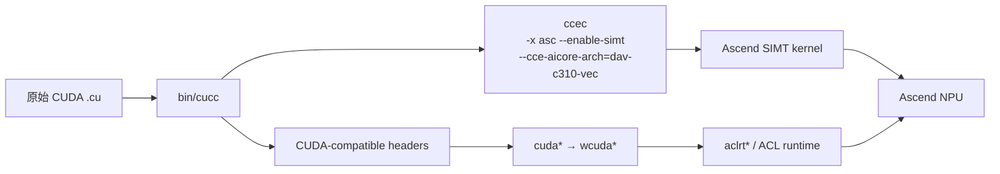

# cu2cce-bridge 项目原理、设计哲学与运行逻辑

> 当前正式路线：`main / puresimt`。
> 当前目标环境：Ascend 950 / CANN 9.2.0 / `ccec` / `dav-c310-vec`。

## 1. 一句话理解项目

cu2cce-bridge 的目标不是把 CUDA 程序“翻译成另一种语言”，而是：

> **让用户继续写原始 CUDA，通过编译器和兼容层把同一份 CUDA 程序运行在昇腾 NPU 上。**

用户看到的是：

```text
CUDA .cu
```

桥接层内部完成的是：

```text
CUDA-compatible headers
+ CUDA host API wrapper
+ CANN ccec SIMT frontend
+ ACL runtime linkage
```

用户不应该看到、也不应该手写：

```text
acl*
__simt_vf__
__global__[aicore]
cce::async_invoke
__gm__
```

## 2. 设计哲学

### 2.1 CUDA 是用户语言，不是中间表示

CUDA `.cu` 是项目的用户输入和兼容性边界。它不是先被解析成 AST，再转换成
Ascend C 或自定义 kernel DSL 的中间文件。

因此 main 的原则是：

```text
用户 CUDA 源码保持原样
```

允许改变的是编译命令、头文件解析路径、host 符号绑定和后端链接方式，而不是用户
kernel 的源代码结构。

### 2.2 能复用编译器，就不要自己重写编译器

Ascend 950 的 ccec 在 `--enable-simt` 下可以直接理解 CUDA SIMT kernel。既然
前端已经能够处理：

- `__global__`；
- `threadIdx/blockIdx/blockDim/gridDim`；
- `<<<>>>`；
- shared memory；
- SIMT synchronization；

那么项目不再维护 Python 文本转换器，也不再生成 kernel wrapper。

这比“自己解析 CUDA，再生成 Ascend C”更符合零改写目标，也减少：

- 语法覆盖缺口；
- 模板/宏/注释/表达式重写错误；
- 隐藏参数 ABI；
- 中间文件生命周期；
- 用户源码与生成源码不一致的问题。

### 2.3 后端差异藏在兼容层，不扩散到用户代码

用户写：

```cpp
cudaMalloc(...);
cudaMemcpy(...);
```

内部走：

```text
cudaMalloc → wcudaMalloc → aclrtMalloc
cudaMemcpy → wcudaMemcpy → aclrtMemcpy
```

用户写：

```cpp
__syncthreads();
atomicAdd(...);
```

内部通过兼容头绑定到：

```text
__syncthreads → asc_syncthreads
atomicAdd      → asc_atomic_add
```

这是“藏匿后端差异”，不是“改写用户程序”。

### 2.4 证据优先，不把声明当成支持

项目的支持状态必须由真机结果决定：

```text
头文件有声明       ≠ 已支持
编译成功            ≠ 已支持
返回 ACL_SUCCESS   ≠ CUDA 语义完整
真机结果校验通过    = SUPPORTED 的必要证据
```

完整状态见：

```text
docs/03_Comparison/PURESIMT_COMPATIBILITY_MATRIX.md
```

## 3. 总体架构



项目可以分成四层：

| 层 | 目录 | 作用 |
|---|---|---|
| 用户源码层 | `examples/puresimt/`、用户自己的 `.cu` | 保持 CUDA 原始写法 |
| 编译驱动层 | `bin/cucc` | 注入参数、头文件、SIMT API、库，直接调用 ccec |
| 兼容头层 | `include/` | CUDA 名称、类型、枚举、SIMT 原语兼容 |
| 运行时层 | `src/bridge/runtime/` | `wcuda* → aclrt*`，负责初始化、内存、stream、event 等 |

独立的 BLAS 层：

```text
src/bridge/blas/
include/bridge/blas/
```

属于 experimental secondary capability，不参与 puresimt 主线验收。

## 4. 编译时的完整逻辑

### 4.1 用户调用

用户可以直接执行两步编译/链接：

```bash
cucc -c demo/vector_add.cu -o demo/build/vector_add.o  # 编译，不链接
cucc demo/build/vector_add.o -o demo/build/vector_add    # 链接
./demo/build/vector_add                                     # 运行
```

其中 `.o` 是目标文件，最终可执行文件由第二条链接命令生成。

### 4.2 `cucc` 做什么

`bin/cucc` 负责：

1. 识别 `.cu` 编译单元或 `.o` 链接阶段；
2. 选择 CANN 自带 `ccec`；
3. 对 `.cu` 将 `-x asc` 放在输入文件之前；
4. 注入：
   - bridge `include/`；
   - shadow headers；
   - CANN include；
   - `simt_api` include；
   - `simt_adaptor.h`；
5. 对 kernel 编译注入：

```text
--enable-simt
--cce-aicore-arch=dav-c310-vec
```

6. 链接阶段注入：
   - `libcce_bridge_runtime.so`；
   - CANN runtime libraries；
   - rpath。

### 4.3 main 明确不做什么

`cucc` 不做：

- Python kernel conversion；
- `.cu → .cce` 文本生成；
- `__global__ → __global__[aicore]` 改写；
- `__simt_vf__` 插入；
- `cce::async_invoke` 插入；
- hidden `bx/by/bz` 参数注入。

因此 `cucc` 是“参数和依赖驱动”，不是“CUDA 源码转换器”。

## 5. Host Runtime 运行逻辑

### 5.1 初始化

用户第一次调用 CUDA runtime API 时，bridge 建立 ACL 运行环境：

```text
aclInit
  → aclrtGetDeviceCount
  → aclrtSetDevice(0)
  → aclrtCreateContext
  → aclrtSetCurrentContext
```

这一步解决了 Ascend 常见的：

```text
107002
No valid context is bound to the current thread
```

因此所有可能直接触发 `aclrtMalloc` 的入口都必须确保初始化已经发生，例如：

- `wcudaMalloc`；
- `wcudaMallocPitch`；
- host/device memory API；
- stream/event 相关 API。

### 5.2 内存

普通内存：

```text
cudaMalloc → wcudaMalloc → aclrtMalloc
cudaFree   → wcudaFree   → aclrtFree
```

同步拷贝：

```text
cudaMemcpy → wcudaMemcpy → aclrtMemcpy
```

为了保持 CUDA 的阻塞式 D2H 语义，device-originating synchronous copy 会先确保
设备工作完成。

二维拷贝：

```text
cudaMemcpy2D
  → wcudaMemcpy2D
  → 按行调用 aclrtMemcpy
```

这是 bridge 的兼容 fallback，用于保留 CUDA 的 `pitch/width/height` 语义。

pitch 分配：

```text
cudaMallocPitch
  → wcudaMallocPitch
  → BRIDGE_INIT
  → aclrtMalloc
```

当前实现使用简化 pitch 规则，不能承诺 CUDA GPU 上的具体硬件对齐策略。

### 5.3 Stream 与 Event

```text
cudaStreamCreate       → aclrtCreateStream
cudaStreamSynchronize   → aclrtSynchronizeStream
cudaStreamDestroy      → aclrtDestroyStream

cudaEventCreate        → aclrtCreateEvent
cudaEventRecord        → aclrtRecordEvent
cudaEventSynchronize   → aclrtSynchronizeEvent
cudaEventElapsedTime   → aclrtEventElapsedTime
```

CUDA 默认 stream、显式 stream、多 kernel 顺序和 event 语义已经由主线样例覆盖。

## 6. Device SIMT 运行逻辑

### 6.1 原始 CUDA kernel

用户写：

```cpp
__global__ void add(const float *a, const float *b, float *c, int n) {
    int i = blockIdx.x * blockDim.x + threadIdx.x;
    if (i < n) c[i] = a[i] + b[i];
}
```

main 直接让 ccec 编译这段代码。项目不产生第二份 kernel 源文件。

### 6.2 SIMT 兼容头

`include/bridge/kernel/simt_adaptor.h` 只做必要的名字映射：

| CUDA | Ascend SIMT |
|---|---|
| `__shared__` | `__ubuf__` |
| `__syncthreads()` | `asc_syncthreads()` |
| `__threadfence()` | `asc_threadfence()` |
| `atomicAdd` | `asc_atomic_add` |
| `atomicSub` | `asc_atomic_sub` |
| `atomicMin/Max` | `asc_atomic_min/max` |
| `__shfl_down_sync` | `asc_shfl_down` |
| `__all/any/ballot_sync` | `asc_all/any/ballot` |

### 6.3 Collective 的控制流要求

CUDA warp collective 必须由 mask 覆盖的 lane 一起执行。例如：

```cpp
int any = __any_sync(0xffffffffu, predicate);
if (threadIdx.x == 0) {
    output[0] = any;
}
```

不能写成：

```cpp
if (threadIdx.x == 0) {
    output[0] = __any_sync(0xffffffffu, predicate);
}
```

后者违反 collective 的参与规则，可能产生错误结果或未定义行为。

## 7. 测试集合如何证明兼容性

当前 23 个用例不是随机堆积，而是按功能正交维度组织：

- 官方 NVIDIA 源码：证明“原始 CUDA 不改写”；
- minimal vector/matrix：隔离基础 kernel/runtime；
- arithmetic/math/core ops：证明标量运算基础；
- atomic/reduction/scan/dot：证明并行归约和原子；
- shuffle/vote：证明 warp collective；
- shared/dynamic shared/transpose/stencil：证明内存协作；
- event/pitched copy/multi-kernel：证明 runtime ordering；
- 3D indexing/fence：证明索引和内存顺序；
- half/BF16x2：证明精度类型接口。

正式状态见：

```text
docs/03_Comparison/PURESIMT_COMPATIBILITY_MATRIX.md
```

## 8. BLAS 为什么单独隔离

cublas/aclblas 不属于 puresimt kernel 语义本身，而是 host library compatibility。
当前 bridge 的 GemmEx 路径还依赖：

- device alpha/beta；
- `lda/ldb/ldc=-1`；
- OPP/ATC 单算子模型；
- FP32 输入到 FP16 的 fallback；
- 可能的精度差异。

因此它保留在：

```text
EXPERIMENTAL
```

不能用于证明 puresimt 主线是否成立，也不参与 `PURESIMT_REGRESSION_PASS` 的必要条件。

## 9. 如何维护项目

新增 CUDA 测试时同步更新：

1. `examples/puresimt/*.cu`；
2. `tools/real_test/server_cmd.txt`；
3. `examples/puresimt/README.md`；
4. `docs/03_Comparison/PURESIMT_COMPATIBILITY_MATRIX.md`。

修改 Runtime API 时同步更新：

1. wrapper 实现；
2. compatibility matrix 状态；
3. `CURRENT_STATE.md` 摘要；
4. `ASCEND_RESEARCH_NOTES.md` 事实。

真机唯一验收命令：

```bash
bash tools/real_test/server_cmd.txt
```

## 10. 项目摘要

cu2cce-bridge 的 main 分支采用 puresimt 正式路线：不改写用户 CUDA 源码，不生成
Ascend kernel 包装代码，而是复用 CANN ccec 的 CUDA SIMT 前端；项目只在兼容头和
host runtime bridge 中封装 Ascend 差异。当前在 Ascend 950 / CANN 9.2.0 上，已用
官方 NVIDIA CUDA Samples 和最小 CUDA 语义用例验证 23 个功能维度，唯一真机回归
输出为 `PURESIMT_REGRESSION_PASS`。
