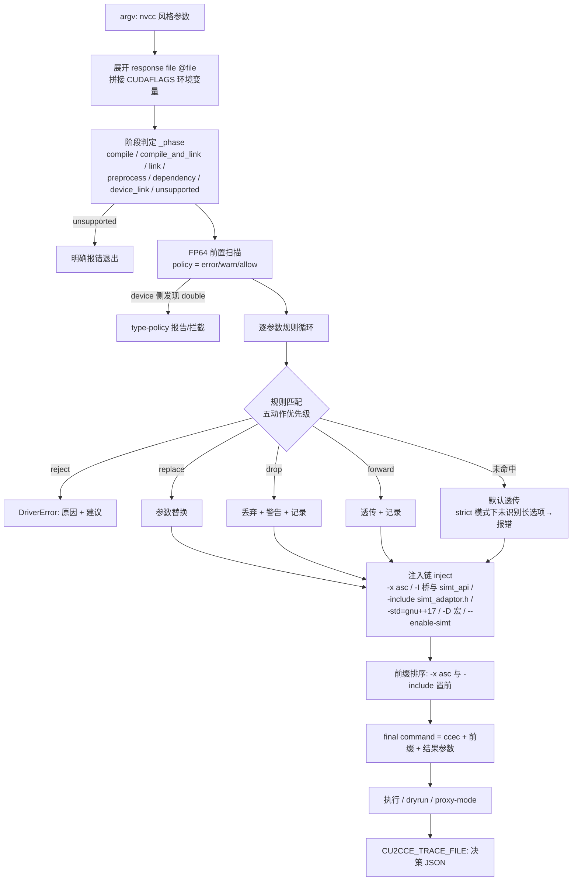
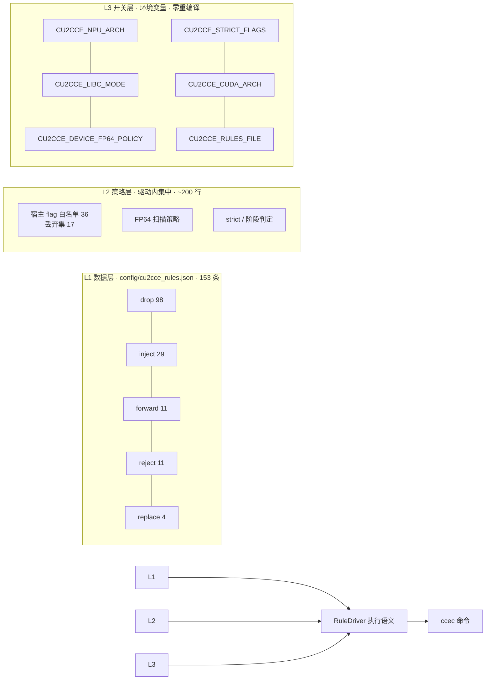

# cucc 兼容性实现详解（驱动、反硬编码与适配）

> 回答导师问题：**cucc 的兼容性是怎么实现的？为什么能做到"不硬编码"？**
> 入口 `bin/cucc` → `tools/cu2cce_driver.py`（RuleDriver，988 行）。
> 同一驱动被 `tools/mock/mock_nvcc.py` 进程内复用（CMake 路径）。

## 1. 问题定义

nvcc 的参数面极大且语义繁杂（数百个选项、多种产品线概念：架构/代码生成/
优化/链接/分隔编译/调试），ccec 的参数面完全不同（`-x asc`、
`--cce-aicore-arch`、`--enable-simt`…），运行时库也不同。驱动的职责是
**协议翻译器**：把 nvcc 协议翻译成 ccec 协议，同时把"无法翻译"的部分
**如实暴露**而不是静默丢弃。

导师的约束"**不让硬编码**"因此落地为一条设计规则：

> **"某个参数遇到 ccec 该怎么处理"是数据，不是代码。**
> 处理规则全部存放在 `config/cu2cce_rules.json`，驱动只实现五种动作的
> 执行语义与匹配算法。新增兼容项 = 修改 JSON（零代码、零重编译）。

## 2. 驱动主流程图



## 3. 五种规则动作（真实 JSON 片段）

```jsonc
// config/cu2cce_rules.json —— 153 条规则，全部数据驱动
// compile.drop：NVIDIA 架构参数不伪造 Ascend 架构
{ "tokens": ["-gencode"], "takes_value": true,
  "when": "source_is_cuda",
  "reason": "NVIDIA GPU 架构不映射 Ascend" }

// compile.reject：puresimt 不产 NVIDIA 中间产物
{ "tokens": ["--ptx"], "when": "source_is_cuda",
  "reason": "PTX 不被 puresimt 消费" }

// compile.inject：SIMT 适配层强制前置
{ "tokens": ["-include", "${CUCC_PATH}/include/bridge/kernel/simt_adaptor.h"],
  "when": "source_is_cuda_and_has_adaptor" }

// link.inject：运行时桥
{ "tokens": ["-l", "cce_bridge_runtime"], "when": "has_cucc" }

// all.forward：普通参数
{ "tokens": ["-std=c++17"], "reason": "ordinary compiler argument" }

// all.replace：-Xcompiler 语义展开（宿主选项转发给 g++）
{ "pattern": "-Xcompiler", "takes_value": true, "split_value": true,
  "reason": "forward host compiler options" }
```

> 注：真实 JSON 里 forward/reject/drop 的书写形态多样（`tokens` 数组或
> `pattern` 通配），此处节选做了形式统一以便阅读；语义与仓库一致。

条件谓词（`when`）由驱动计算后传入：`source_is_cuda`、`has_cucc`、
`has_simt_api`、`system_libc / not_system_libc`、`shared_link_without_pic`、
`has_cuda_arch`、`source_is_cuda_and_has_adaptor`——谓词是**能力探测**，
不是参数名枚举。

## 4. 兼容性决策表（常见 nvcc 参数的实际去向）

| nvcc 参数 | 驱动处理 | ccec 侧效果 |
|---|---|---|
| `-c` / `-o` | forward + 阶段判定 | 编译对象 |
| `-std=c++17` | forward → `-std=gnu++17` 注入 | C++17 |
| `-O2/-O3` | forward | 交给 ccec 优化管线 |
| `-I/-L/-D/-l` | forward | 语义一致 |
| `-gencode arch=...,code=...` / `-arch=sm_86` | drop + 警告 | 架构由 `--cce-aicore-arch`（CU2CCE_NPU_ARCH）决定 |
| `-m64` | drop + 警告 | 宿主位数由工具链决定 |
| `-Xcompiler -fPIC` | 白名单放行→注入到宿主编译 | 宿主选项生效 |
| `-Xcompiler -m64` | 丢弃集 + 警告 | 宿主位数选项无意义 |
| `--ptx / -ptx / --cubin / -fatbin / -S` | **reject** | puresimt 不产 NVIDIA 中间产物 |
| `-rdc=true / --device-link` | **reject** | RDC 语义后端不支持（multi-`.cu` 边界） |
| `-M / -MD / -MF / -MT` | forward | 依赖生成（真机输出待验，DIAGNOSTIC_ONLY） |
| `-lcublas` | WARN_FORWARD + 桥运行时注入 | 不自动替换库（诚实边界；cublas 走实验线） |
| `@response_file` | 展开递归处理 | 支持 |
| `--use_fast_math / -G / -maxrregcount` | drop + 警告 | ccec 无对应/语义不同 |
| `-Xcompiler -fPIC` 之外的别名 `--compiler-options` | replace（split 后逐个走宿主策略） | 同 -Xcompiler |

## 5. 三层适配模型（反硬编码的落地结构）



| 层 | 判据 | 新增兼容项的成本 |
|---|---|---|
| L1 数据 | "某参数遇到 ccec 该怎么处理" | **改 JSON 三步，零代码**（校验器 → dryrun → trace） |
| L2 策略 | "整体编译语义/风险策略" | 改驱动内集中策略集（均有真机证据） |
| L3 开关 | "不改代码可调的行为" | 设环境变量 |

**诚实清单**：目前仍在代码层的只有宿主 flag 策略集（36+17 项）与 FP64
扫描逻辑——前者外部化到 JSON 已列为规划项（校验器同步扩展），后者因
涉及语义扫描（区域判定/ErrMsg 适配）保留代码但档位已由 L3 暴露。
**流程逻辑（阶段判定、注入顺序）不伪装成数据**——那是流程，不是数据。

## 6. FP64 前置策略流程（语义级兼容的例子）

```mermaid
graph TD
    A[compile 阶段 + CUDA 源 + policy != allow] --> B[只读扫描源码<br/>词法层: 剥注释/字符串, 保留行号]
    B --> C[定位 __device__/__global__ 区域<br/>含参数表与原型]
    C --> D{区域内有 double/doubleN?}
    D -->|无| E[放行 → ccec]
    D -->|有| F{policy?}
    F -->|error 默认| G[打印 [type-policy] file:line 清单<br/>+ 手动改 float 指引 → 编译前终止]
    F -->|warn| H[同报告 → 继续编译<br/>后端原生报错亦归并解释]
    F -->|allow| I[跳过扫描]
```

背景：**昇腾 device 侧完全没有 double**（连 doubleN 向量类型都不存在，
真机 `unknown type name 'double2'` 实证）——所以"编译前指路"是唯一诚实
的兼容方式。扫描器为词法启发式（宏生成签名可能漏报、浮点字面量不在
范围），限制如实写入文档。

## 7. 可观测性（兼容性的"仪表盘"）

| 手段 | 用途 |
|---|---|
| `CU2CCE_DEBUG=1` | 逐参数决策 stderr（drop/forward/inject + 原因） |
| `CU2CCE_TRACE_FILE=f.json` | 结构化决策 trace（inputs/actions/injected/final_args） |
| `cucc --dryrun` | 只打印最终 ccec 命令 |
| `cucc --proxy-mode` | shlex 单行输出（供包装器消费） |

任何一次编译的"为什么这样处理"都可回放——这是适配性可维护性的最终标准。

## 8. 验证体系（兼容性不是靠感觉）

| 层 | 验证 |
|---|---|
| 数据层 | `tools/validate_cucc_rules.py`（结构/动作/谓词合法性） |
| 行为层 | 52 个契约测试（驱动阶段/规则决策/FP64 策略/CMake 探测/mock 应答） |
| 真机层 | 六门禁回归（23 puresimt + 6 CMake 案例 + make/ninja + 外部样本）+ BLAS 三用例 |

## 9. 新增兼容需求 SOP（给后续维护者）

1. **新 nvcc flag**：判定语义 → L1 加 JSON → 校验器 → dryrun → trace → 真机；
2. **新策略**：进 L2 集中策略区 + L3 开关暴露档位 + 契约测试；
3. **新平台事实**：先探针取证（`inventory_simt_api.sh` / ErrMsg）→ 落
   `04_shadow_headers.md` §6 或 `02_deep_dive.md` §6 平台事实清单 →
   对应层实现 → 契约测试锁行为。
