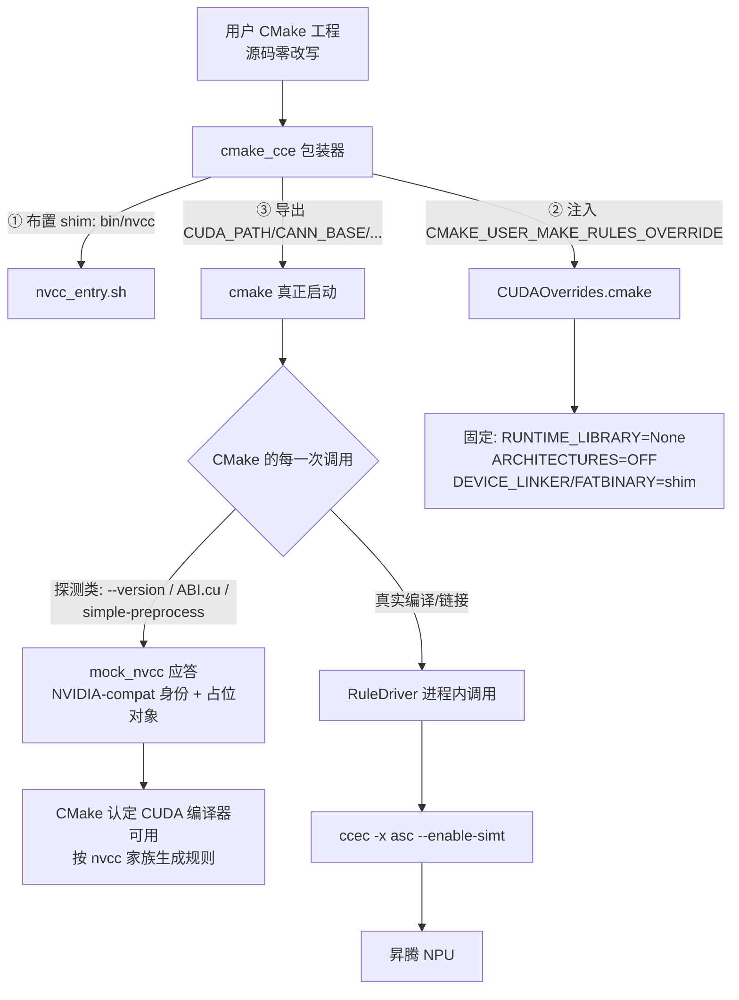
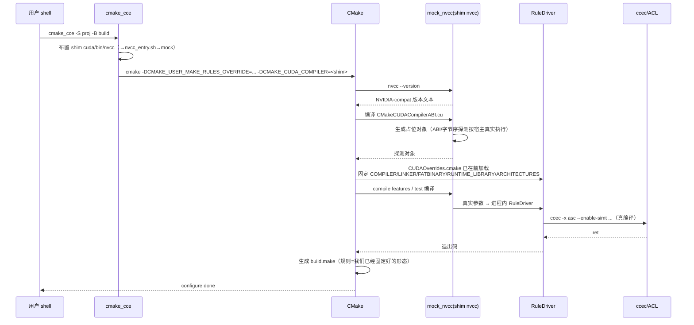

# CMake 兼容性实现详解（Principle & Flow）

> 回答导师问题：**CMake 的 CUDA 兼容是怎么实现的？**
> 与 `05_cmake_design.md`（设计+能力清单）互补，本文给实现细节与流程图。
> 所有机制真机验证（main@51f0382+，六门禁全绿）。

## 1. 问题定义：难在哪

一个标准 CUDA 工程的 CMakeLists 会写：

```cmake
project(my_proj LANGUAGES CXX CUDA)          # ① 触发 CUDA 编译器探测
find_package(CUDAToolkit REQUIRED)           # ② 触发 Toolkit 发现
add_executable(app foo.cu main.cpp)          # ③ 触发规则生成 + 编译 + 链接
target_link_libraries(app PRIVATE CUDA::cudart)
```

CMake 内部对 CUDA 语言的处理流程是：**探测编译器身份 → 询问 ABI/features →
按"识别出的编译器家族"生成编译/链接规则**。昇腾侧的现实是：**没有 nvcc，
只有语义相近但参数体系不同的 `ccec`，运行时是 ACL 而非 libcudart**。

因此兼容层要同时伪造三样东西，又不能伪造语义：

| CMake 期待 | 现实 | 兼容层对策 |
|---|---|---|
| 一个行为像 nvcc 的可执行文件 | 不存在 | shim 目录 + mock nvcc（探测应答）+ RuleDriver（真编译翻译） |
| NVIDIA 编译器身份特征 | ccec 是 clang 15 系 | mock 应答 NVIDIA-compat 身份 + override 固定变量 |
| cudart 链接与 CUDA 架构体系 | 桥运行时 + 无 GPU 架构概念 | FindCUDAToolkit 别名族 + ARCHITECTURES OFF 强制 |

## 2. 总体方案流程图



**备选方案为什么被否决**（导师常追问）：

| 备选 | 否决理由 |
|---|---|
| patch CMake 源码/发 CMake 补丁 | CMake 版本面太宽（3.18~3.30+），维护成本爆炸；override 机制是 CMake 官方提供的注入点 |
| 写一个完整的假 nvcc 可执行 | 探测面之外还需 100% 复刻 nvcc 行为，语义漂移不可控；mock 只答探测、真编译统一走驱动，两条路共享同一实现 |
| 只用 `-DCMAKE_CUDA_COMPILER=ccec` | CMake 会按 clang 家族生成 `--cuda-gpu-arch` 等 clang 参数给 ccec，参数体系错位；必须由 override+mock 先把"身份"立住 |
| LD_PRELOAD / 二进制 patch nvcc | 侵入系统、不可复现、违背零信任调试原则 |

## 3. configure 时序图（逐条消息）



**关键分叉**：CMake 的调用被分成"探测类"与"真实类"。探测类由 mock 直接
应答（绝不打 ccec——探测参数对 ccec 无意义）；真实类进程内进 RuleDriver。
**同一驱动服务两条路**，保证"CMake 眼中的行为 = 命令行行为"。

## 4. 各层实现细节

### 4.1 cmake_cce（入口）

- 生成 shim：`$CU2CCE_CMAKE_SHIM_DIR/cuda/bin/nvcc → nvcc_entry.sh`，
  外加 device-linker/fatbinary 同名占位（CMake ≥3.21 会探测它们）；
- 注入：`-DCMAKE_USER_MAKE_RULES_OVERRIDE=<...>/CUDAOverrides.cmake` 与
  `..._OVERRIDE_CUDA=<同一文件>`（override 在**语言探测之前**加载，
  这是 CMake 官方扩展点）；
- 导出：`CUDA_PATH=<shim>`、`CANN_BASE`、`CU2CCE_NPU_ARCH`、
  `CU2CCE_LIBC_MODE`；透传用户其余 `-D/-G` 参数。

### 4.2 mock_nvcc（探测应答器）

| CMake 调用 | mock 行为 | 为什么 |
|---|---|---|
| `--version` | NVIDIA-compat 文本（vendor 正则命中 CMake 的 NVIDIA 判定） | 让 CMake 走 nvcc 家族规则分支 |
| `CMakeCUDACompilerABI.cu` 编译 | 生成占位对象（ABI/位数/字节序探测按宿主真实执行） | 探测对象只被 CMake 读二进制特征，占位即可；真语义在后续真实编译 |
| `--simple-preprocess`（≥3.24） | 预置宏文本（`__CUDACC_VER_*` 等） | 特性列表查询 |
| `__cmake_determine_cuda` 内部探针 | 短路 | |
| 其余一切参数 | **进程内 RuleDriver → ccec** | 保证探测应答与真实编译共享同一实现 |

### 4.3 CUDAOverrides.cmake（规则固化）

| 变量 | 值 | 目的 |
|---|---|---|
| `CMAKE_CUDA_COMPILER` | shim nvcc | 与 mock 一致 |
| `CMAKE_CUDA_DEVICE_LINKER/FATBINARY` | shim 占位 | 免去对 nvlink/fatbinary 的探测（CMake ≥3.21） |
| `CMAKE_CUDA_RUNTIME_LIBRARY` | `None` | cudart 语义由桥运行时承接，阻止 CMake 自动链 cudart |
| `CMAKE_CUDA_ARCHITECTURES` | `OFF` | NVIDIA sm_XX 无意义且触发 `.cubin` 产物管线（真机失败教训） |

### 4.4 FindCUDAToolkit / CUDA:: 别名族

`find_package(CUDAToolkit)` 命中桥模块后提供：
`CUDA::cudart`（桥运行时 + ACL 依赖）、`CUDA::toolkit`（include 面）、
`CUDA::cudart_static/cudadevrt` 别名——`target_link_libraries(app PRIVATE
CUDA::cudart)` 照常工作；另有 `cu2cce::runtime` 原生包（区分"桥"与
"伪 CUDA Toolkit"）。

## 5. 一次真实构建的命令 trace（真机）

configure 后 `cmake --build`，`.cu.o` 规则实际执行（`CU2CCE_DEBUG` 可见）：

```text
cucc -c vector_add.cu -o CMakeFiles/demo.dir/vector_add.cu.o \
     -I <install>/include -I <cann>/include \
     -include <install>/include/bridge/kernel/simt_adaptor.h \
     --cuda-path <shim>/cuda ...
  → 驱动丢弃 --cuda-path（提示：工具链由 cu2cce/CANN 选定）
  → 最终：
/usr/local/Ascend/latest/bin/ccec -x asc \
     -I <install>/include ... -include .../simt_adaptor.h \
     -c vector_add.cu -o vector_add.cu.o \
     -std=gnu++17 -D __CU2CCE_DEVICE_COMPILATION__ -D CUDA_VERSION=11060 \
     --cce-aicore-arch=dav-c310-vec --enable-simt
```

host `.cpp` 由系统 g++ 编译；链接由 g++ 执行并注入
`-lcce_bridge_runtime -lascendcl ...`（运行时桥承接 cudart 语义）。

## 6. 边界与失败模式处理（均有真机证据）

| 场景 | 现象 | 处理 |
|---|---|---|
| 上游样本自设 `CUDA_ARCHITECTURES sm_61..120` | CMake 生成按架构 `.cubin` 规则 → ld.lld 报错 | override 后按 TARGET 守卫扫回 OFF（CUBIN/FATBIN 属性仅 OBJECT 目标可设——CMake 硬校验） |
| 多目录 include 传播 | 裸路径被 CMake 判 source-dir-prefix 错 | 生成器表达式 `$<BUILD_INTERFACE>` / `$<INSTALL_INTERFACE>` |
| multi-`.cu` 静态库 | ld duplicate symbol（后端注册符号聚合缺口） | 构建面放行、host 链接失败记 DIAG-ONLY（边界文档化，不伪装修复） |
| 构建树陈旧 | configure 报错 | 自动回退全量 reconfigure |
| 外部官方样本 | 固定版本接入 + 5 样本选择性构建 | 类型守卫 + 每样本独立构建段 |

## 7. 能力清单回链

能力正/反面清单：`../03_Scope/SUPPORTED_SCOPE.md` /
`LIMITS_AND_BOUNDARIES.md`；机制内部（cucc 驱动与反硬编码）：
`07_cucc_adaptability.md`；设计决策历史：`docs/archive/`。
